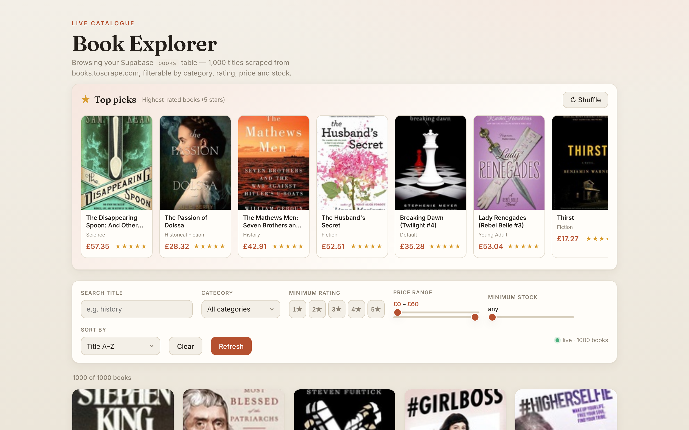
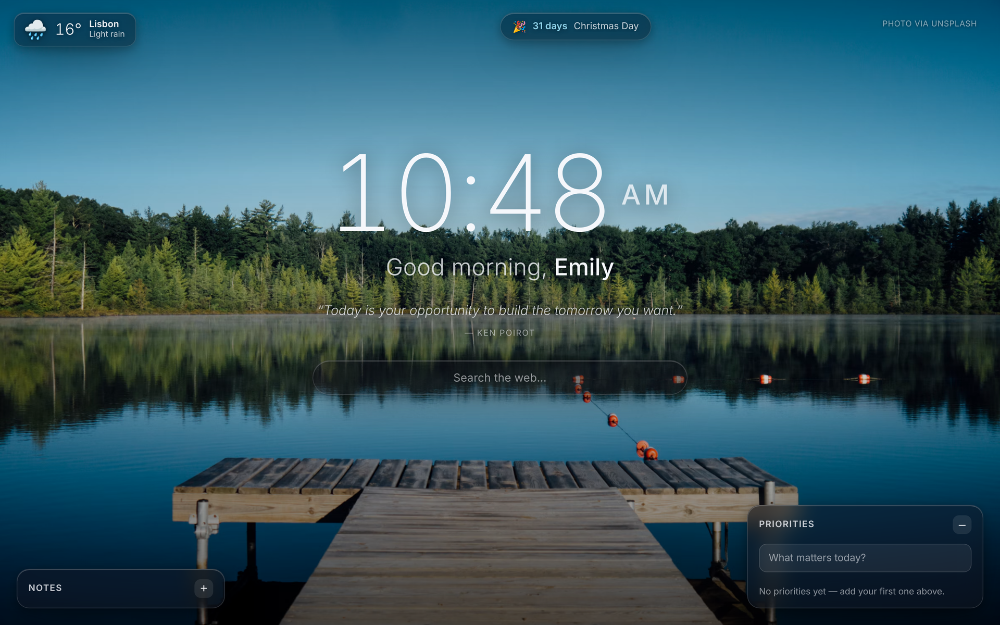
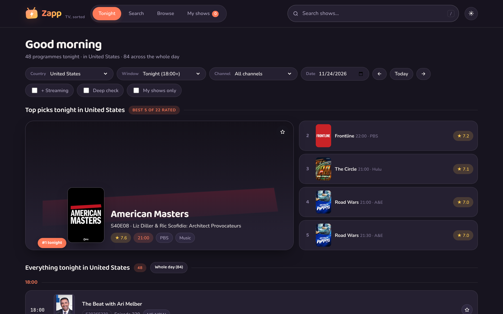

# Emily-AI-Fundamentals

Individual assignment for **Applied Programming and AI Fundamentals** (Nova,
Semester 3).

Three small, self-contained projects: a web scraper with a live database-backed
explorer, a Chrome new-tab extension, and a single-file TV guide. None of them need a
build step, and **each folder has its own detailed README** covering purpose, data
collection, persistence, interaction, setup, what I learned and the project's
limitations.

| Project | What it is | Built with |
| --- | --- | --- |
| [**get-books**](get-books/) | Scrapes 1,000 books from a practice site into Supabase, plus a browser explorer to filter them live | Python, BeautifulSoup, Supabase/Postgres, vanilla JS |
| [**my-monomentum**](my-monomentum/) | A calm Momentum-style new tab page for Chrome — clock, weather, priorities, quotes | Chrome extension (Manifest V3), vanilla JS/CSS |
| [**zapp**](zapp/) | A TV guide and show browser for the TVmaze API, in one HTML file | Vanilla JS, IndexedDB, jsdom tests |

Common thread: each one takes data from somewhere it doesn't control — a website's
HTML, two public APIs — and has to decide what to store locally and why. They move
outward from a server-side pipeline, through a browser extension, to a single file
that is an entire application.

---

## At a glance

The assignment's required headings, answered for the repository as a whole. Each
project's own README answers all of them in full detail for that project.

**Purpose** — three independent programs, each taking data from a source it doesn't
control and turning it into something usable: a scraping pipeline that ends in a live
filterable database, a Chrome extension that replaces the new tab page, and a
single-file TV guide built on a public API.

**Data collection** — `get-books` scrapes HTML from
[books.toscrape.com](https://books.toscrape.com) with `requests` + BeautifulSoup,
following the site's own pagination links. `my-monomentum` calls
[Open-Meteo](https://open-meteo.com) for weather and loads Unsplash images; everything
else it needs is bundled or computed locally. `zapp` reads six endpoints of the
[TVmaze API](https://www.tvmaze.com/api) through a throttled transport layer. No API
keys are required by any of them, and no data is collected about the user.

**Data persistence** — `get-books` writes a CSV snapshot (a checkpoint, so a loader
bug doesn't mean re-crawling) and upserts the rows into Supabase/Postgres keyed on
`detail_url` (so re-running updates rather than duplicates). `my-monomentum` stores
name, priorities, notes and cached weather in `chrome.storage.local`.
`zapp` keeps the watchlist, watched episodes and theme in `localStorage`, and its
91,242-show index plus full schedule in IndexedDB, because those exceed
`localStorage`'s ~5 MB limit. Nothing is stored on a server, and no secrets are
committed.

**User interaction** — `get-books` is a web page with search, sort, rating and price
filters. `my-monomentum` is the browser's new tab: click to edit the greeting, type to
add priorities or notes, search from the bar. `zapp` is a web page with Tonight,
Search, Browse, show detail and My Shows views, keyboard shortcuts and a theme toggle.

**Setup** — none of the three needs a build step. `get-books` needs Python with
`requests` and `beautifulsoup4`, plus two environment variables for the Supabase
loader. `my-monomentum` is loaded unpacked via `chrome://extensions`.
`zapp` runs by opening one HTML file; `npm install && npm test` runs its 176 tests.
Per-project instructions are in each README.

**Screenshots** — one per project, shown in that project's section below and in each
project README.

**Learning** and **Limitations and assistance** — see the two sections at the end of
this file, and the corresponding sections in each project README.

## 1. get-books — scraping to a live database

→ [folder](get-books/) · [README](get-books/README.md)

Crawls all 50 catalogue pages of [books.toscrape.com](https://books.toscrape.com) (a
public sandbox built for practising scraping), writes one CSV row per book, loads
those rows into a Supabase table, and serves a web page that queries that table live
and lets you filter and sort the results in the browser.

So the project covers the full path end to end: **scrape → CSV → database → UI.**



| File | What it does |
| --- | --- |
| [`scraper/books_scraper.py`](get-books/scraper/books_scraper.py) | The scraper itself. 50 listing requests by default; `--details` also opens each book's own page for UPC, tax, stock count and description. |
| [`scraper/generic_scraper.py`](get-books/scraper/generic_scraper.py) | The same idea made reusable — you describe a site's repeating item and its fields with CSS selectors, and it writes a CSV for any static page. |
| [`data/books.csv`](get-books/data/books.csv) | A snapshot of the scrape: 1,000 books with title, price, availability, rating and links. |
| [`supabase/schema.sql`](get-books/supabase/schema.sql) | The Postgres table, with `detail_url` as the upsert key so re-running the scrape updates rather than duplicates. |
| [`supabase/upload.py`](get-books/supabase/upload.py) | Pushes the CSV into Supabase through its REST API. |
| [`index.html`](get-books/index.html) | The explorer — one page, no dependencies, reads straight from Supabase with the publishable key (the table is read-only via Row Level Security). |

**Run it:**

```bash
pip install requests beautifulsoup4
python get-books/scraper/books_scraper.py   # writes books.csv
open get-books/index.html                   # the explorer
```

Full setup for the database half is in the [project README](get-books/README.md).

---

## 2. my-monomentum — a Chrome new tab page

→ [folder](my-monomentum/) · [README](my-monomentum/README.md)

Replaces Chrome's new tab with a quieter one: a clock and a greeting that changes
through the day, a landscape photo that rotates daily, a priorities checklist, live
Lisbon weather, a fresh quote each time, a search bar, a countdown to the next German
public holiday, and a notes scratchpad.

Everything is stored locally in `chrome.storage.local` — no accounts, no tracking,
nothing leaves the browser. The only two network calls are Unsplash for the photo and
[Open-Meteo](https://open-meteo.com) for the weather, which needs no API key.



| File | What it does |
| --- | --- |
| [`manifest.json`](my-monomentum/manifest.json) | Manifest V3 config — overrides the new tab, requests only `storage` and the two hosts above. |
| [`newtab.html`](my-monomentum/newtab.html) | The page itself. |
| [`js/newtab.js`](my-monomentum/js/newtab.js) | Clock, greeting, background switching and the priorities list. |
| [`js/weather.js`](my-monomentum/js/weather.js) | Live Lisbon weather, refreshed every 15 minutes, last reading cached for offline. |
| [`js/backgrounds.js`](my-monomentum/js/backgrounds.js) | The curated Unsplash photo list; the day's pick is deterministic and preloaded. |
| [`js/quotes.js`](my-monomentum/js/quotes.js) | Bundled quotes, so a new one appears instantly even offline. |
| [`js/holidays.js`](my-monomentum/js/holidays.js) | Computes Germany's nationwide holidays offline, including the moving Easter-based ones. |
| [`js/notes.js`](my-monomentum/js/notes.js) | The autosaving scratchpad. |
| [`css/style.css`](my-monomentum/css/style.css) | Styling, with the colours and layout as CSS variables at the top. |

**Install:** `chrome://extensions` → turn on **Developer mode** → **Load unpacked** →
pick the `my-monomentum` folder. Step-by-step notes are in the
[project README](my-monomentum/README.md).

---

## 3. zapp — a TV guide in one file

→ [folder](zapp/) · [README](zapp/README.md)

A show browser built on the [TVmaze API](https://www.tvmaze.com/api): tonight's
broadcast schedule for any country and date, search, a browsable index of all 91,242
shows, per-show episode guides with watched toggles, and a personal watchlist with
next-episode countdowns.

It is a single HTML file with no build step, no API key and no runtime dependencies —
TVmaze allows cross-origin requests, so it runs straight from `file://`. The
interesting parts are the workarounds for what the API actually does: search is
hard-capped at 10 results, so browsing the full database means indexing 383 pages into
IndexedDB; and the per-country schedule endpoint quietly drops episodes with no
announced airtime, so a "deep check" mode merges four sources and reports what each
contributed. Long lists render through a virtual window, keeping about 42 cards in the
DOM however long the list is.



| File | What it does |
| --- | --- |
| [`zapp.html`](zapp/zapp.html) | The whole app — markup, styles, logic, API transport layer and storage. |
| [`test/run.mjs`](zapp/test/run.mjs) | 176 assertions against the real page in jsdom with mocked API payloads: both schedule shapes, the four-source merge, filters, virtual scrolling, the watchlist round-trip and storage migration. |
| [`package.json`](zapp/package.json) | Just the test script and jsdom; nothing is needed to run the app. |
| [`zapp-logo.svg`](zapp/zapp-logo.svg) | The logo. |

**Run it:**

```bash
open zapp/zapp.html   # that's all

cd zapp && npm install && npm test   # the test suite
```

The [project README](zapp/README.md) also documents what was measured about the TVmaze
API (rate limits, coverage, payload sizes) — findings from the API itself rather than
from its docs.

---

## Learning across the three projects

Each project README has its own Learning section with the specific challenge I hit and
how I worked through it. Three things carried across all of them:

**Data you don't own is never the shape you want it.** In `get-books` the star rating
isn't text on the page at all — it's encoded in a CSS class name. In `zapp` the
per-country schedule endpoint returns a valid, successful response that is quietly
missing programmes. Both produce *wrong data rather than an error*, which is far worse,
and neither is visible from documentation. I stopped treating a `200 OK` as evidence
that I had what I asked for, and started checking the actual payload against something
I could verify independently.

**Decide what to store, and be able to say why.** All three projects store something,
and the reasons differ: `get-books` keeps a CSV *and* a database because they serve
different purposes — a checkpoint so a loader bug doesn't mean re-crawling, and a
queryable copy so a browser can filter it. `zapp` splits across `localStorage` and
IndexedDB not by preference but because 17 MB physically will not fit in a 5 MB store.
`my-monomentum` caches the last weather reading specifically so the page can render
something true instantly instead of flickering. Being able to justify each choice made
them much easier to defend and to change.

**Constraints are better design input than preferences.** The most-used parts of these
projects were shaped by a limit I couldn't negotiate with: a 10-result search cap, a
5 MB storage ceiling, a rate limit of 20 calls per 10 seconds, a new tab page that is
already on screen before the code runs. Working out what the real constraint was
usually told me what to build.

The hardest habit to learn was resisting the first fix. The duplicate rows in
`get-books` could have been patched with a delete-then-insert; the missing episodes in
`zapp` could have been papered over. In both cases the better answer came from asking
*why* the problem existed — no stable identity for a book, no single complete endpoint
— and that produced an upsert key and a multi-source merge instead of a workaround.

## Limitations and assistance

Each project README has a full **Limitations and assistance** section listing what is
incomplete in that project. In summary:

- **get-books** — the committed `schema.sql`, `books.csv` and scraper don't match the
  live Supabase table, which has `category` and `num_available` columns they lack, so
  a fresh clone can't reproduce the database the explorer expects; several `--details`
  fields are scraped but never uploaded; the explorer loads the whole table and
  filters client-side; the generic scraper handles static HTML only.
- **my-monomentum** — the weather location is hard-coded to Lisbon; only
  Germany-wide holidays are covered; backgrounds come from a fixed list; there's no
  settings page and no automated tests.
- **zapp** — limited by TVmaze's coverage (effectively unusable as a German TV guide);
  the full index must be rebuilt manually and never expires; watchlist and watched
  state are per-browser with manual backup; no accessibility audit.

**AI tools, tutorials and external code**

- **Claude** (Anthropic) was used across all three projects — for working through
  approaches, debugging, and reviewing documentation. Specifics are noted in each
  project's README.
- **No external code was copied in.** All three projects are written from scratch.
  There are no frameworks and no runtime dependencies; the only libraries used are
  `requests` and `beautifulsoup4` in `get-books` and `jsdom` for `zapp`'s tests.
- **Third-party data and services**, all free and used within their terms:
  [books.toscrape.com](https://books.toscrape.com) (a sandbox provided for scraping
  practice), [Supabase](https://supabase.com), [Open-Meteo](https://open-meteo.com),
  [Unsplash](https://unsplash.com) and [TVmaze](https://www.tvmaze.com/api). Images and
  poster art remain the copyright of their respective rights holders.
- **One published algorithm** is implemented from its description rather than copied:
  the Anonymous Gregorian algorithm for Easter Sunday, in `my-monomentum/js/holidays.js`.

## Repository layout

```
.
├── get-books/        # scraper → Supabase → web explorer
├── my-monomentum/    # Chrome new tab extension
├── zapp/             # single-file TVmaze TV guide
└── .gitignore        # keeps keys, .env files and build junk out of git
```

No secrets are committed anywhere in this repository. `get-books` uses an environment
variable for its Supabase service key, and the explorer ships only the publishable
read-only key.
