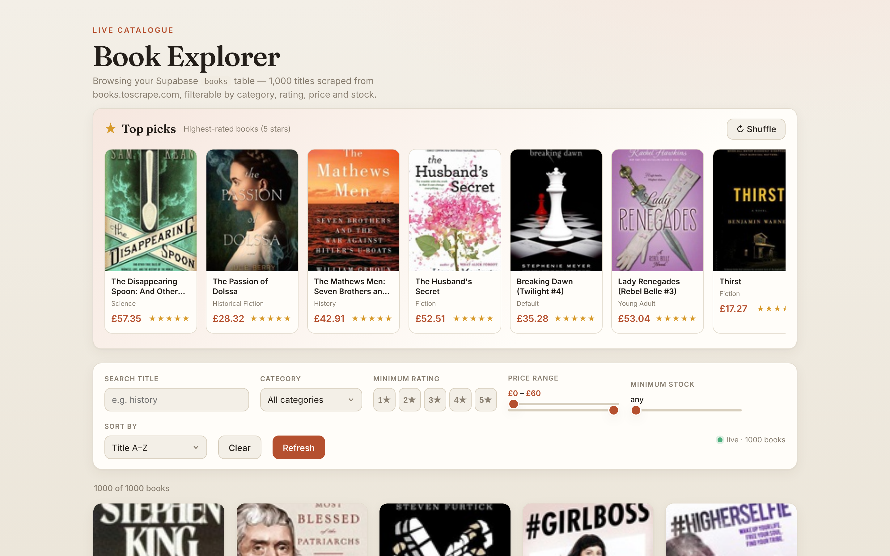

# get-books

Scrapes every book from [books.toscrape.com](https://books.toscrape.com) (1,000 titles
across 50 pages), stores them in a Supabase (Postgres) table, and serves an
interactive web explorer that reads that table live.

## Purpose

An end-to-end data project: **scrape → CSV → database → UI.** The scraper collects a
real dataset from a live website, the loader puts it in a hosted Postgres database,
and the explorer is a browser front end that queries that database and lets you
filter and sort 1,000 books without a page reload. The point was to build every
stage of that path myself rather than stopping at a CSV.

Secondary goal: `scraper/generic_scraper.py` generalises the scraper, so the same
approach can be pointed at another static site by describing its fields in CSS
selectors instead of writing new code.

## What's here

```
index.html            # Interactive book explorer (reads live from Supabase)
scraper/
  books_scraper.py    # Scraper tailored to books.toscrape.com -> CSV
  generic_scraper.py  # Configurable scraper template for other static sites
supabase/
  schema.sql          # Table definition for the books table
  upload.py           # Loads the CSV into Supabase via the REST API
data/
  books.csv           # Snapshot of the scraped data
docs/
  explorer.png        # Screenshot of the explorer
```

## Data collection

All book data comes from [books.toscrape.com](https://books.toscrape.com), a public
sandbox site built specifically for practising web scraping — so crawling it is both
permitted and intended.

`scraper/books_scraper.py` collects it with `requests` + `BeautifulSoup`:

- Starts at the catalogue root and follows the `li.next a` link from page to page
  until there is no next link — 50 pages, ~1,000 books. It follows the site's own
  links rather than guessing URL patterns, so it stops naturally at the end.
- For each `article.product_pod` it reads title, price, availability, star rating,
  the detail-page URL and the cover image URL.
- `--details` additionally opens each book's own page for UPC, product type, tax,
  exact stock count and description. That's ~1,000 extra requests, so it is off by
  default.
- Requests are polite and resilient: a 0.5 s pause between requests, a descriptive
  User-Agent, and three retries with exponential backoff, treating 404 as final.

Output is one CSV row per book, written as `utf-8-sig` so the `£` prices survive
being opened in Excel.

## Data persistence

Two layers, deliberately:

| Where | What | Why |
| --- | --- | --- |
| `data/books.csv` | A flat snapshot of the scrape | A checkpoint. Scraping and loading are separate steps, so a parsing mistake in the loader doesn't mean re-crawling 1,000 pages — and the CSV is a readable artefact of what was actually collected. |
| Supabase (Postgres) `books` table | The queryable copy the web explorer reads | A CSV can't be filtered from a browser. Putting the rows in Postgres means the UI can query, sort and filter server-side over HTTP with no backend of my own to host. |

The table stores `title`, `price_gbp`, `availability`, `rating`, `detail_url`,
`image_url` and a `scraped_at` timestamp, with indexes on price and rating for
sorting. The live table additionally carries `category` and `num_available`, which the
explorer filters on — note that `supabase/schema.sql` in this repo does not yet define
those two columns (see Limitations).

`detail_url` is `unique` and used as the upsert key, so re-running the scrape
**updates** existing books instead of duplicating them — the table can be refreshed
on a schedule and simply stays current.

Nothing personal is stored, and no secrets are committed. The loader takes the
secret `service_role` key from an environment variable; the explorer ships only the
**publishable** key, which is safe in a browser because the table has Row Level
Security with a read-only policy.

## User interaction

Open `index.html` in a browser. It fetches the `books` table and gives you:

- **Category** (50 categories) and **minimum stock** filters
- **Minimum rating** (1–5 stars)
- **Price range** in £
- **Title search**, **sorting**, and a **"Top picks"** row of the highest-rated books

Filtering is instant because the rows are already in the page — there's no reload and
no server round trip per keystroke.

Because the file is named `index.html`, it can also be served as a live site via
**GitHub Pages** (Settings → Pages → Build from branch → `main` / root).

## Setup

**Dependencies:** Python 3 with `requests` and `beautifulsoup4`. The explorer has no
dependencies and needs no build step.

**1. Run the scrape**

```bash
pip install requests beautifulsoup4
python scraper/books_scraper.py            # writes books.csv
python scraper/books_scraper.py --details  # also pulls per-book detail pages
python scraper/books_scraper.py --limit 3  # just the first 3 pages, for testing
```

**2. Create the table** — run `supabase/schema.sql` in Supabase's SQL Editor
(Dashboard → SQL Editor → paste → Run).

**3. Load the data** — credentials come from environment variables so the secret key
never touches the code. Both are in Supabase under Project Settings → API.

```bash
export SUPABASE_URL="https://YOUR-PROJECT.supabase.co"
export SUPABASE_KEY="your-service_role-key"   # server-side only; keep secret
python supabase/upload.py
python supabase/upload.py --dry-run           # parse and validate, upload nothing
```

**4. Open the explorer**

```bash
open index.html
```

To point it at your own Supabase project, edit `SUPABASE_URL` and `SUPABASE_KEY`
near the top of the script block in `index.html` and use your **publishable** key.

## Screenshot



## Learning

**What I learned.** That the fragile part of scraping isn't fetching pages, it's that
a website's HTML is a presentation format, not a data format. The star rating isn't
text anywhere on the page — it's encoded in a CSS class (`<p class="star-rating
Three">`), so it has to be read out of the class list and mapped back to a number.
The visible title is truncated with an ellipsis, so the full one has to come from the
link's `title` attribute instead of its text. Prices arrive with a `£` that turns
into mojibake if the encoding is assumed rather than checked. None of that is visible
until you look at the real markup, and each one silently produces wrong data rather
than an error.

I also learned the value of splitting a pipeline at the file boundary. Scrape-to-CSV
and CSV-to-database are separate scripts, and that separation paid off repeatedly:
every time I got the loader wrong I could re-run it in seconds instead of re-crawling
the site.

**A challenge: re-running the scrape created duplicates.** My first loader just
`POST`ed every row, so the second run gave me 2,000 books instead of 1,000 — and
since the data has no natural ID, there was nothing obvious to deduplicate on.

How I approached it: I looked for a field that identifies a book permanently rather
than describing it. Titles aren't unique and prices change, but every book has its
own detail page, so `detail_url` is a stable identity. I made that column `unique` in
the schema and switched the loader to an upsert — Supabase's REST API does this with
`Prefer: resolution=merge-duplicates` plus `on_conflict=detail_url`. Now a re-run
updates the 1,000 existing rows rather than inserting new ones, which turned the
loader from a one-shot script into something safe to run repeatedly.

The second challenge was credentials. The explorer runs in the browser, so any key it
uses is public. The fix wasn't to hide the key but to use a different one: the secret
`service_role` key stays server-side in an environment variable for the loader, and
the browser gets the publishable key, with Row Level Security on the table enforcing
read-only access. That reframed the problem from "hide the secret" to "give the
browser a key that can't do damage."

## Limitations and assistance

**Incomplete features**

- **The committed code can't reproduce the live database.** The live Supabase table
  has `category` and `num_available` columns, and the explorer filters on both — but
  `schema.sql` doesn't define them, `data/books.csv` doesn't contain them, and
  `books_scraper.py` never captures `category` at all (it appears only in the sidebar
  navigation, not on the product card). So cloning this repo and following the setup
  steps produces a narrower table than the explorer expects, and those two filters
  come up empty. Realigning the scraper, the CSV and the schema with the live table is
  the main outstanding task.
- **`--details` data is only partly stored.** The scraper can pull UPC, product type,
  tax, stock count and description, but `upload.py` sends only the six listing
  columns, so UPC, product type, tax and description never reach the database.
- **The explorer loads the whole table at once** (up to 2,000 rows) and filters in the
  browser. That is fine for 1,000 books and would need real server-side pagination for
  a larger table.
- **`generic_scraper.py` only handles static HTML.** Sites that render their content
  with JavaScript return nothing useful, since there's no browser engine involved.
- **No scheduled refresh.** The upsert makes re-running safe, but nothing runs it
  automatically.
- The setup notes inside `upload.py` still refer to the files by their old names
  (`supabase_schema.sql`, `supabase_upload.py`).

**Assistance**

- **Claude** (Anthropic) was used while building this project — for working through
  the scraping approach, the upsert/`on_conflict` pattern, debugging the encoding of
  the `£` prices, and reviewing this documentation.
- **Data source:** books.toscrape.com, a sandbox site provided for scraping practice.
- **External services:** [Supabase](https://supabase.com) for hosted Postgres and its
  REST API.
- **Libraries:** `requests` and `beautifulsoup4`. No external code was copied into
  this project; the scrapers, schema, loader and explorer are written from scratch.
