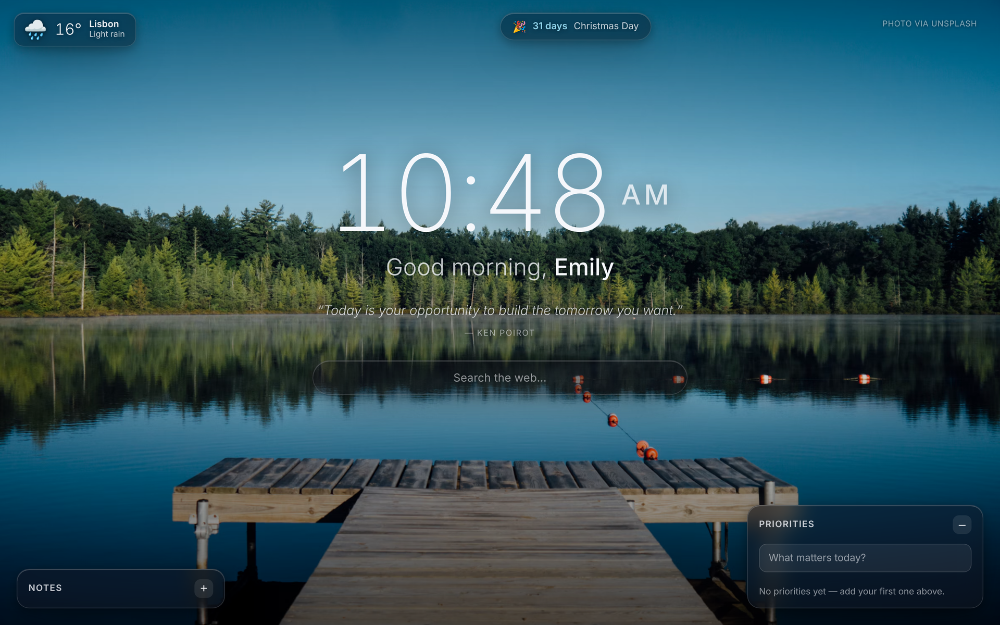

# Emilys Monomentum

A calm, Momentum-style **new tab page** for Chrome — clock and greeting, a daily
background, priorities, live weather, a quote, a holiday countdown and notes.

## Purpose

Chrome's default new tab is a grid of thumbnails of sites I'd just closed. This
replaces it with something calmer and actually useful, and it's a Manifest V3 Chrome
extension, so it's a real browser extension rather than a web page.

Every time you open a new tab you get:

- 🕑 **A live clock with a personal greeting** — "Good morning, Emily", changing
  through morning / afternoon / evening. Click the name to change it.
- 🌄 **A daily rotating background** — a high-resolution landscape photo from
  Unsplash, one per day, cached so it loads instantly and falling back to a soft
  gradient when offline.
- ✅ **A priorities list** — jot down what matters today, check things off, clear
  completed items, collapse the card for a clean view. Saved locally.
- 🌦️ **Live Lisbon weather** — temperature, conditions and an icon, from
  [Open-Meteo](https://open-meteo.com).
- 💬 **A fresh quote on every tab** — bundled in, so it's instant and works offline.
- 🔎 **A web search bar** — type, press Enter, search.
- 🇩🇪 **German public-holiday countdown** — days until the next nationwide holiday,
  computed offline.
- 📝 **Notes scratchpad** — a collapsible notepad that autosaves as you type.

## Data collection

Almost everything is computed or bundled locally. There are exactly **two** network
calls, and `manifest.json` requests host permissions for only those two hosts:

| Source | What it provides | How |
| --- | --- | --- |
| [Open-Meteo](https://open-meteo.com) `api.open-meteo.com` | Current Lisbon temperature and conditions | A `fetch` with Lisbon's latitude/longitude hard-coded, on load and then every 15 minutes, plus when you return to the tab. No API key required. |
| Unsplash `images.unsplash.com` | The daily background photo | Images only, from a curated list of photo IDs in `js/backgrounds.js`. No API call — the IDs are fixed, so the day's photo is chosen locally and only the image is downloaded. |

Everything else needs no network at all:

- **Quotes** are bundled in `js/quotes.js`, so a new one appears instantly even
  offline.
- **German public holidays** are *calculated*, not fetched. `js/holidays.js` computes
  Easter Sunday with the Anonymous Gregorian algorithm and derives Good Friday, Easter
  Monday, Ascension Day and Whit Monday from it, alongside the six fixed-date
  holidays.
- **Clock, greeting and countdown** come from the system clock.

No analytics, no tracking, no accounts. Nothing about you is sent anywhere.

## Data persistence

Everything is stored **locally on your own machine** via `chrome.storage.local`,
with a `localStorage` fallback so the page also works when `newtab.html` is opened
directly as a file.

| Key | What it holds | Why it's stored |
| --- | --- | --- |
| `userName` | The name in the greeting | So the greeting is personal without an account |
| `priorities`, `prioritiesCollapsed` | Today's list and whether the card is collapsed | A to-do list that vanished on every new tab would be useless |
| `notes`, `notesCollapsed` | Scratchpad text and its collapsed state | Debounced at 400 ms so it saves as you type without writing on every keystroke |
| `bg`, `bgCache` | The current background and cached image URLs | So the photo appears immediately instead of fading in on every tab |
| `weather` | The last reading | So the last known temperature shows instantly, and still shows when offline |
| `quote` | The current quote | So it changes per tab deliberately rather than randomly re-rendering |

Nothing is stored remotely and no personal data leaves the browser. Uninstalling the
extension removes all of it.

## User interaction

Install it (below) and open a new tab — that's the whole interface. Within it:

- **Click your name** in the greeting to change it.
- **Type in the priorities box** and press Enter to add an item; click an item to
  check it off; use the clear button to remove completed ones.
- **Click the collapse arrows** on the priorities or notes cards to tidy the view.
- **Type in the search bar** and press Enter to search the web.
- **Type in the notes pad** — it saves itself.

## Setup

**Dependencies:** none. No build step, no package manager, no API keys.

**Install (load unpacked)** — this isn't on the Chrome Web Store, so you load it from
source:

1. Download or clone this repository.
2. Open Chrome and go to `chrome://extensions`.
3. Turn on **Developer mode** (top-right toggle).
4. Click **Load unpacked** and select the `my-monomentum` folder (the one containing
   `manifest.json`).
5. Open a new tab — done. 🎉

To update later, `git pull` and click the **refresh** icon on the extension card in
`chrome://extensions`.

> Chrome only allows one extension to control the new tab page at a time. If another
> new-tab extension is installed, disable it first.

For quick testing without installing, opening `newtab.html` directly in a browser
also works — it falls back to `localStorage`.

**Configuration**

- **Your name** — click the name in the greeting on the page itself.
- **Weather location** — `LAT` and `LON` at the top of [`js/weather.js`](js/weather.js)
  (currently Lisbon).
- **Background photos** — the `UNSPLASH_PHOTO_IDS` list in
  [`js/backgrounds.js`](js/backgrounds.js). Each entry is an Unsplash photo ID (the
  part after `photo-` in an `images.unsplash.com` URL).
- **Colors & layout** — the CSS variables at the top of
  [`css/style.css`](css/style.css).

## Screenshot



## Project structure

```
my-monomentum/
├── manifest.json        # MV3 extension manifest
├── newtab.html          # the new tab page
├── css/
│   └── style.css        # styling
├── js/
│   ├── backgrounds.js   # curated Unsplash photo list
│   ├── weather.js       # live Lisbon weather (Open-Meteo)
│   ├── quotes.js        # bundled quotes, a new one each open
│   ├── holidays.js      # German public-holiday countdown (offline)
│   ├── notes.js         # autosaving notes scratchpad
│   └── newtab.js        # clock, greeting, background & priorities logic
├── icons/               # 16 / 48 / 128 px icons
└── docs/                # screenshot
```

## Learning

**What I learned.** That a new tab page is a performance problem disguised as a design
problem. It opens many times a day, and the user is already looking at it before the
code runs — so anything that arrives late doesn't just feel slow, it visibly flickers.
That one constraint decided most of the architecture: the clock paints first because
it needs no storage at all; quotes are bundled rather than fetched so they never
block; background images are picked deterministically per day and preloaded; and the
weather renders its cached value immediately, then quietly replaces it when the live
reading arrives. The principle I took away is to render something truthful instantly
and upgrade it, rather than waiting for the real answer.

I also learned how different "the same" storage API can be. `chrome.storage.local` is
asynchronous and callback-based; `localStorage` is synchronous and string-only.
Writing both into one promise-returning helper (in `js/newtab.js`) meant every other
module could just `await store.get([...])` and not care which backend it got — which
is also why the page still works opened directly as a file.

**A challenge: the German holiday countdown couldn't be hardcoded.** Four of
Germany's nine nationwide holidays — Good Friday, Easter Monday, Ascension Day and
Whit Monday — move every year, because they're all defined relative to Easter Sunday,
whose date follows a lunar rule rather than the calendar. My first version had a
hardcoded list of dates, which meant it would silently become wrong in January and I
wouldn't notice.

My first instinct was to fetch the dates from a public holiday API. I decided against
it: it would have added a third network dependency and a point of failure to something
that is pure arithmetic, and it would have broken the offline guarantee for a widget
that just counts days. So I implemented the Anonymous Gregorian algorithm for Easter
Sunday instead, and derived the four movable holidays as fixed offsets from it
(−2, +1, +39, +50 days). The whole thing is about thirty lines, needs no network, and
is correct for any year. I checked the output against the published dates for several
years, including a leap year, to be sure the arithmetic was right.

The debugging lesson that cost me the most time was date arithmetic in JavaScript:
`new Date(year, 0, 1)` uses zero-indexed months, and comparing dates that carry a time
component made "days until" off by one depending on the hour of day. Normalising
everything to midnight before subtracting fixed it.

## Limitations and assistance

**Incomplete features**

- **The weather location is fixed to Lisbon** in `js/weather.js`. There's no UI to
  change it and no geolocation — changing city means editing the file.
- **Holidays are Germany-wide only.** State-specific holidays (Reformationstag,
  Allerheiligen, Fronleichnam and others) aren't included, so the countdown is wrong
  for people in states that observe them.
- **Backgrounds come from a fixed, curated list** of Unsplash IDs rather than the
  Unsplash API, so the variety is limited to what's in the file, and photographer
  attribution isn't shown per-image.
- **No settings page.** Everything configurable other than the name is configured by
  editing source files.
- **Priorities don't reset or roll over.** The list persists indefinitely; there's no
  notion of "today" clearing it.
- **Not published to the Chrome Web Store**, so it has to be loaded unpacked, and no
  automated tests cover it.

**Assistance**

- **Claude** (Anthropic) was used while building this project — for the Manifest V3
  structure, the promise-based storage wrapper, working through the Easter/holiday
  calculation, and reviewing this documentation.
- **External services:** [Open-Meteo](https://open-meteo.com) for weather (free, no
  API key); [Unsplash](https://unsplash.com) for the background photographs, which
  remain the copyright of their photographers.
- **Reference:** the Anonymous Gregorian algorithm for computing Easter is a
  published algorithm, implemented here from its description rather than copied.
- **Libraries:** none. All HTML, CSS and JavaScript is written from scratch, with no
  frameworks or dependencies.
- **Inspiration:** the [Momentum](https://momentumdash.com) extension, which this
  imitates in spirit; no code from it was used.

## License

MIT — see [LICENSE](LICENSE).

---

Photos courtesy of the photographers on [Unsplash](https://unsplash.com/).
