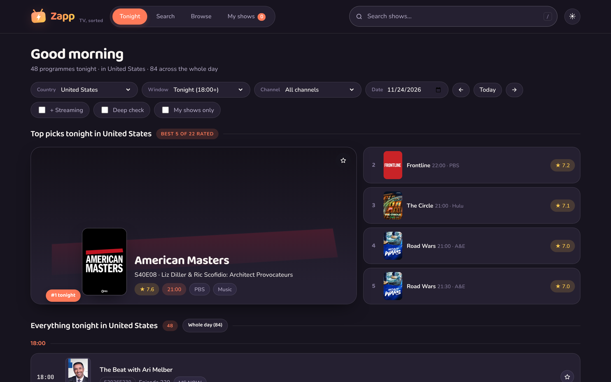

# Zapp

A TV guide and show browser built on the [TVmaze API](https://www.tvmaze.com/api) —
one self-contained HTML file, no build step, no API key, no runtime dependencies.

## Purpose

A TV guide that answers "what's actually on tonight?" and "where do I watch this
show from here?" in one place, plus a browsable index of TVmaze's entire 91,242-show
database and a personal watchlist with next-episode countdowns.

Technically it's an exercise in building a complete application against a public API
inside the limits that API actually imposes — which turned out to be the interesting
part, since several of those limits aren't documented.

Open `zapp.html` in a browser and it works. TVmaze sends
`Access-Control-Allow-Origin: *`, so it runs straight from `file://` or any static
host.

## Features

**Tonight** — the broadcast schedule for any country and date, grouped by airtime,
with a time window (tonight from 18:00, prime time 20:00–23:00, or the whole day). A
top-picks block ranks the best-rated programmes in that window as one hero card plus
four runners-up. Filter by channel or by shows you follow. Streaming is an opt-in
toggle.

**Deep check** — for countries other than the US, sweeps every schedule source
TVmaze exposes, including `/schedule/full`, which holds the TBA-airtime episodes the
country endpoint silently drops. Reports exactly what each source contributed.

**Search** — `/search/shows`, with sort (relevance, rating, newest, A–Z) and
genre/channel filters built from the result set.

**Browse** — all 91,242 shows. Opens with lazy 240-per-page loading; "Index
everything" walks all 383 index pages (~4 minutes, ~17 MB slimmed) into IndexedDB,
after which filtering and sorting cover the whole database.

**Show detail** — synopsis, genres, rating, network, links out to IMDb and the
official site; a season-by-season episode guide with per-episode watched toggles and
season progress; cast list.

**My shows** — star anything; next-episode countdowns via `embed[]=nextepisode`,
sorted by what airs soonest. Backup/restore via a JSON list of show IDs.

Plus a light/dark theme, `/` to focus search, Esc to close, and hash routing between
views.

## Data collection

Everything comes from the [TVmaze API](https://www.tvmaze.com/api), which is free,
public and needs no API key or account. Nothing is collected about the user.

The endpoints used:

| Endpoint | Used for |
| --- | --- |
| `/schedule?country=&date=` | The main per-country broadcast schedule |
| `/schedule/full` | The complete schedule, including TBA-airtime episodes the country endpoint omits |
| `/schedule/web?country=` | Streaming releases (global and per-country) |
| `/search/shows?q=` | Search |
| `/shows?page=N` | The full show index — 383 pages of 240 |
| `/shows/:id` with `embed[]=` | Show detail, episodes, cast, next episode |

Requests go through one transport layer that throttles to 16 calls per 10 seconds
with 4 concurrent, and backs off on HTTP 429 — just inside TVmaze's measured limit of
about 20 per 10 seconds per IP. The footer shows a live count of API calls made
versus cache hits.

### Notes on the TVmaze API

Measured 18–19 November 2026, from the API itself rather than from its documentation:

- **Search is hard-capped at 10 results.** Every query returns at most 10, and
  `&page=` changes nothing. The database holds 91,242 shows, so search alone can never
  reach most of it — hence the Browse index.
- **`/shows?page=N` is the real index**: 383 pages of 240, ~1,557 bytes per show
  (~135 MB in full). Slimmed to the fields a list needs, it's ~194 bytes per show
  (~17 MB).
- **`/schedule?country=X` silently drops episodes with no announced airtime.** On
  18 Nov it omitted 11 US entries that `/schedule/full` had, including *Jeopardy!*,
  *Wheel of Fortune* and *Tamron Hall*.
- **Coverage is overwhelmingly US/UK.** That day: US 95 listings across 30 networks,
  GB 26, AU 19, CA 4, DE 2, FR 0. Sampling 1,173 shows found 7 on German networks
  (0.6%).
- **It is a series database, not an EPG.** No repeats — every listing is a premiere
  airing. 42% of the US day was news programming; only 10 scripted titles aired.
  Tagesschau, heute-journal and Wer wird Millionär? aren't in it at all.
- **Streaming lives on separate endpoints.** `/schedule/web?country=` returns global
  services, `?country=XX` local ones. Streaming releases are timestamped at or near
  midnight, so they rarely fall inside an evening window.
- **Rate limit** is about 20 calls per 10 seconds per IP.

## Data persistence

Everything is stored in the browser, on the user's own machine. There is no account,
no server and no sync — nothing ever leaves the browser.

| Where | What | Why |
| --- | --- | --- |
| `localStorage` | The watchlist (show IDs), watched-episode state, theme choice | Small, needs to be read synchronously on first paint, and must survive restarts |
| IndexedDB (database `zapp`, store `shows`) | The 91,242-show index and the ~11 MB full schedule | `localStorage` caps out around 5 MB, so the big caches physically cannot live there |
| In-memory promise cache | Responses within a session | Avoids re-requesting the same endpoint while navigating between views |

The split is forced by size, not preference. Every storage access is wrapped, so if
storage is unavailable or full the app degrades to in-memory and keeps working for
the session.

The watchlist stores only show IDs — not titles or metadata — so it stays tiny and is
easy to back up or restore as a JSON list.

## User interaction

Open `zapp.html` in any browser. No install, no sign-up, no key.

- **Tonight** opens by default. Pick a country and date, choose a time window, and
  filter by channel or by followed shows.
- **Search** with `/` to focus the box; sort and filter the results by genre or
  channel.
- **Browse** to page through all shows, or click **Index everything** once (~4
  minutes) to make the whole database locally filterable and sortable.
- **Click any show** for its synopsis, cast and season-by-season episode guide; tick
  episodes as watched.
- **Star a show** to add it to **My shows**, which sorts by what airs soonest.
- **Toggle light/dark**, and press **Esc** to close any panel.

## Setup

**Dependencies:** none to run. `jsdom` only for the test suite.

**Run it**

```bash
open zapp.html
```

That's all. No configuration, no API key, no server.

**Tests**

```bash
npm install
npm test
```

176 assertions run against the real page in jsdom with mocked API responses shaped
like the live payloads. They cover both schedule shapes, the four-source merge and
de-duplication, filters, virtual scrolling, the watchlist round-trip through
`localStorage`, episode watched-state, the theme toggle, and storage migration.

## Screenshot



## Implementation notes

- **Transport** splits into `request()` (throttled, uncached) and `get()` (throttled
  plus a promise cache). The full-index sync uses `request()` — caching 383 pages of
  full records would pin ~135 MB for nothing.
- **Virtual scrolling** positions cards by `transform` inside an absolutely-positioned
  window, re-rendered on scroll via `requestAnimationFrame`, with a spacer reserving
  the full height. ~42 cards stay in the DOM regardless of list length.
- **Show summaries arrive as HTML** and are stripped to text before rendering, so API
  content can't inject markup.

## Learning

**What I learned.** That an API's documentation describes what it offers, and only
measurement tells you what it does. Almost every significant decision in this project
came from something I found by probing the API rather than reading about it: that
search returns at most 10 results no matter what you ask, that the full index is 383
pages, that the per-country schedule quietly omits episodes. If I had trusted the
docs, I would have built a search box over a 91,242-show database that could only
ever surface 10 of them, and a TV guide that was silently missing programmes. Writing
down what I measured — with dates, counts and byte sizes — turned out to be as
valuable as the code, because those numbers are what justify the architecture.

The second thing I learned is that browser storage has hard physical limits that
dictate design. I didn't choose IndexedDB because it's nicer; I moved to it because
17 MB will not fit in a 5 MB `localStorage`, full stop. Several parts of this app are
shaped by a constraint rather than a preference, and recognising which is which made
it much easier to stop second-guessing them.

**A challenge: the schedule was missing programmes, and nothing reported an error.**
Building the Tonight view, I noticed well-known US shows — *Jeopardy!*, *Wheel of
Fortune* — simply weren't in the listings. There was no error, no empty response, no
warning. The endpoint returned a perfectly valid schedule that was quietly incomplete.

How I approached it: rather than guessing, I compared sources. I pulled the same day
from `/schedule?country=US` and from `/schedule/full` and diffed the two by show ID.
That isolated it immediately — 11 entries existed in the full feed and not in the
country one, and all 11 shared a single property: no announced airtime. The
per-country endpoint evidently filters on airtime and drops anything TBA.

The fix became a feature. Since no single endpoint is complete, "deep check" merges
four sources and de-duplicates them, and rather than hiding that, it reports what each
source contributed — so when the listing looks thin, you can see whether that's the
data or the app. I added a test with both payload shapes (with and without airtime) so
a regression here fails loudly instead of silently dropping shows again.

The broader lesson was about trusting a successful response. A `200 OK` with
well-formed JSON felt like confirmation that everything was fine, and it wasn't. The
only reason I caught it was that I happened to know what should have been on. Now the
app cross-checks instead of relying on me noticing.

**Testing a single-file app** was its own challenge: there are no modules to import,
so there's nothing to unit-test in the usual way. I ended up loading the real
`zapp.html` into jsdom with `fetch` mocked to return payloads shaped like the live
ones, which tests the actual shipped page rather than a copy of its logic.

## Limitations and assistance

**Incomplete features**

- **Coverage is limited by the data, not the code.** TVmaze is a series database, not
  a true EPG: no repeats, no regional variations, and non-English-language television
  is thinly covered (0.6% of a 1,173-show sample was on German networks). For German
  TV specifically this is not a usable guide — Tagesschau and similar aren't in the
  database at all. Fixing it properly would mean a second data source.
- **"Index everything" takes about 4 minutes** and has to be triggered manually. There
  is no incremental or background update, so the local index goes stale and the only
  remedy is a full re-index.
- **No cache expiry.** The IndexedDB index and schedule persist until re-indexed;
  nothing invalidates them on a schedule.
- **Watched-episode state and the watchlist are per-browser.** There's no account or
  sync, so they don't follow you to another device — backup/restore is manual, via a
  JSON list of show IDs.
- **Search is capped at 10 results by the API** and cannot be worked around except via
  the local index, so searching before indexing gives a much shallower result set.
- **No accessibility audit** has been done — keyboard shortcuts exist, but screen
  reader support and focus management in the virtual-scrolling list are untested.
- Streaming releases are timestamped near midnight upstream, so they rarely appear in
  an evening window even when the toggle is on.

**Assistance**

- **Claude** (Anthropic) was used while building this project — for the throttled
  transport layer, the virtual-scrolling implementation, diagnosing the missing-episode
  problem across endpoints, setting up the jsdom test harness, and reviewing this
  documentation.
- **Data:** [TVmaze](https://www.tvmaze.com/api), free and without an API key. Poster
  art is served from TVmaze and remains © its respective rights holders.
- **Libraries:** `jsdom`, for tests only. The application itself has no dependencies
  and no framework — all markup, styles and logic are written from scratch in one
  file.
- **The API findings above are my own measurements**, taken 18–19 November 2026, not
  quoted from TVmaze's documentation.

## Credits

Data by [TVmaze](https://www.tvmaze.com/api), free and without an API key. Poster art
is served from TVmaze and remains © its respective rights holders.
